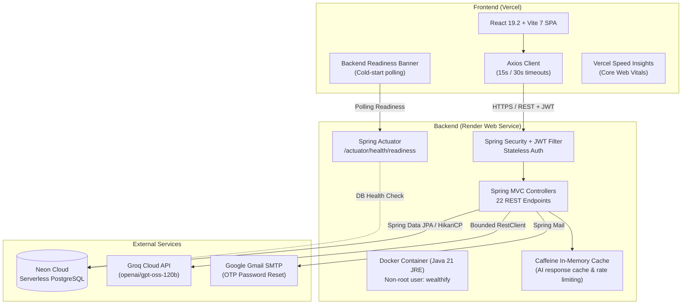

# Wealthify

[](https://openjdk.org/)
[](https://spring.io/projects/spring-boot)
[](https://react.dev/)
[](https://vitejs.dev/)
[](https://tailwindcss.com/)
[](https://www.postgresql.org/)
[](https://www.docker.com/)

**Wealthify** is a full-stack personal finance application and budgeting co-pilot tailored for Indian college students. It combines disciplined 50/30/20 budgeting with generative AI expense categorization, wasteful spending detection, student-friendly savings goals, and entry-level Indian market investment guidance.

- **GitHub Repository**: [https://github.com/RISHABHXVAZ/Wealthify](https://github.com/RISHABHXVAZ/Wealthify)
- **Deployment Topology**: Single-page application hosted on **Vercel**, containerized Spring Boot backend on **Render**, and serverless PostgreSQL on **Neon Cloud**.

---

## Architecture Overview



---

## Core Features

- **AI-Powered Expense Categorization**:
  When an expense is logged (`POST /api/expenses`), the backend sends the transaction description to Groq LLM (`openai/gpt-oss-120b`). The model tags the category, identifies spending type (`NEED` vs. `WANT`), and flags potential wastefulness against the student's remaining budget. If the external AI service times out or errors, resilient fallback defaults ensure the transaction is recorded without blocking the user.
- **50/30/20 Budget Engine**:
  Computes budget allocations across Needs (50%), Wants (30%), and Savings/Investments (20%) tailored to student monthly allowances, surfacing current spending status (`HEALTHY`, `CAUTION`, `CRITICAL`).
- **Wasteful Spending & Analytics**:
  Aggregates expenditures by category, tracks daily and monthly trends, and highlights discretionary leaks (e.g. repeated online food deliveries or recurring entertainment subscriptions).
- **Target Savings Goals**:
  Enables students to establish financial milestones (e.g. laptop, exam fees) with progress tracking, incremental contributions, and AI-assisted timeline recommendations.
- **Indian Market Investment Advisory**:
  Provides educational asset-allocation suggestions (Nifty 50 index ETFs, Gold ETFs, liquid funds) scaled to modest student surpluses.
- **Render Free-Tier Cold-Start Adaptation**:
  Because Render's free tier spins down idle containers, an early readiness service (`frontendReadinessManager`) automatically probes `/actuator/health/readiness` with exponential backoff and informs users via a banner until the backend is fully awake.
- **Defensive API Timeouts**:
  Frontend Axios requests are bounded (15 seconds for standard operations, 30 seconds for AI and SMTP operations) to prevent hanging loading spinners.

---

## Technology Stack

| Layer | Technologies |
| :--- | :--- |
| **Frontend** | React 19.2, Vite 7.3, Tailwind CSS v4, Recharts 3.8, Lucide React, Axios, React Router v7 |
| **Backend** | Spring Boot 4.0.3, Java 21 LTS, Spring Data JPA, Spring Security 6, JJWT 0.12.3, Caffeine Cache, Jakarta Validation |
| **Database** | PostgreSQL 16+ (Neon Serverless in production; Zonky in-JVM native binary in integration tests) |
| **AI & External** | Groq Cloud API (`openai/gpt-oss-120b`), Google Gmail SMTP for OTP emails |
| **DevOps & Hosting** | Docker (multi-stage build, non-root user `wealthify:wealthify`), Render, Vercel |
| **Monitoring** | Spring Boot Actuator health probes, Vercel Speed Insights |

---

## Project Structure

```
Wealthify/
├── README.md                                 # Root project documentation & portfolio guide
├── .gitignore                                # Root exclusions for OS, IDE, and environment clutter
├── docs/
│   ├── api-reference.md                      # Complete reference for all 22 REST endpoints
│   ├── performance-audit.md                  # Comprehensive end-to-end performance audit report
│   ├── production-health-probes.md           # Render Actuator health probes deployment runbook
│   └── production-index-migration.md         # PostgreSQL composite index migration runbook
├── backend/
│   ├── Dockerfile                            # Multi-stage Eclipse Temurin Java 21 non-root image
│   ├── pom.xml                               # Maven build configuration
│   ├── mvnw / mvnw.cmd                       # Maven wrappers for Linux/macOS and Windows
│   ├── .env.example                          # Backend environment variable template
│   └── src/
│       ├── main/java/com/Wealthify/backend/  # Controllers, services, repositories, entities, security
│       ├── main/resources/                   # application.properties, schema-indexes.sql
│       └── test/java/com/Wealthify/backend/  # 37 test classes (330 tests executed via Zonky embedded PostgreSQL)
└── frontend/
    ├── package.json / vite.config.js         # React 19 + Vite 7 build configuration
    ├── .env.example                          # Frontend environment variable template
    ├── vercel.json                           # Static asset immutable caching & SPA rewrite rules
    ├── README.md                             # Frontend-specific architecture and script guide
    ├── src/                                  # React components, pages, contexts, readiness services
    └── test/                                 # 26 automated unit/contract tests (node --test)
```

---

## Local Development Setup

### Prerequisites
- **Java**: JDK 21 LTS installed (`java -version`)
- **Node.js**: Node 20.x or later installed (`node -v`)
- **Database**: A running PostgreSQL 16+ instance, a free [Neon](https://neon.tech) cloud database, or local Docker container

---

### 1. Backend Setup

Spring Boot reads environment variables from the host operating system or system properties; it does not automatically load unmanaged `.env` files.

#### Option A: Using `application-local.properties` (Recommended for Local Dev)
Create a file at `backend/src/main/resources/application-local.properties` (this file is git-ignored):

```properties
spring.datasource.url=jdbc:postgresql://localhost:5432/wealthify
spring.datasource.username=postgres
spring.datasource.password=your_local_password
spring.jpa.hibernate.ddl-auto=update

# Cryptographically secure random secret (min 256 bits)
app.jwt.secret=your_development_jwt_secret_must_be_at_least_256_bits_long_here!

# Groq Cloud API Key (or placeholder for offline testing)
groq.api.key=gsk_your_groq_api_key_here

# Outbound Mail (used for password reset OTP; set dummy values for local dev)
spring.mail.username=dev@example.com
spring.mail.password=devpassword
```

Start the backend with the `local` profile explicitly activated:

**On Linux / macOS:**
```bash
cd backend
./mvnw spring-boot:run -Dspring-boot.run.profiles=local
```

**On Windows (PowerShell / CMD):**
```powershell
cd backend
.\mvnw.cmd spring-boot:run -Dspring-boot.run.profiles=local
```

#### Option B: Exporting Shell Environment Variables

**On Windows (PowerShell):**
```powershell
cd backend
$env:SPRING_PROFILES_ACTIVE="local"
$env:SPRING_DATASOURCE_URL="jdbc:postgresql://localhost:5432/wealthify"
$env:SPRING_DATASOURCE_USERNAME="postgres"
$env:SPRING_DATASOURCE_PASSWORD="your_local_password"
$env:SPRING_JPA_HIBERNATE_DDL_AUTO="update"
$env:APP_JWT_SECRET="your_development_jwt_secret_must_be_at_least_256_bits_long_here!"
$env:GROQ_API_KEY="gsk_your_groq_api_key"
$env:SPRING_MAIL_USERNAME="dev@example.com"
$env:SPRING_MAIL_PASSWORD="devpassword"

.\mvnw.cmd spring-boot:run
```

**On Linux / macOS:**
```bash
cd backend
export SPRING_PROFILES_ACTIVE=local
export SPRING_DATASOURCE_URL=jdbc:postgresql://localhost:5432/wealthify
export SPRING_DATASOURCE_USERNAME=postgres
export SPRING_DATASOURCE_PASSWORD=your_local_password
export SPRING_JPA_HIBERNATE_DDL_AUTO=update
export APP_JWT_SECRET=your_development_jwt_secret_must_be_at_least_256_bits_long_here!
export GROQ_API_KEY=gsk_your_groq_api_key
export SPRING_MAIL_USERNAME=dev@example.com
export SPRING_MAIL_PASSWORD=devpassword

./mvnw spring-boot:run
```

> [!IMPORTANT]
> - Always set `SPRING_PROFILES_ACTIVE=local` in development. Production defaults to `prod`, which enables strict CORS enforcement and `ddl-auto=validate` (which will fail if tables do not exist).
> - Setting `SPRING_JPA_HIBERNATE_DDL_AUTO=update` allows Hibernate to generate schema tables on first launch.
> - Outbound mail placeholders (`SPRING_MAIL_USERNAME`, `SPRING_MAIL_PASSWORD`) are required at startup to satisfy Spring Mail context initialization; real Gmail credentials are only necessary if testing password reset OTP emails.

The backend will start and listen on `http://localhost:8080`.

---

### 2. Frontend Setup

In a separate terminal:

```bash
cd frontend

# Copy configuration template (defaults to http://localhost:8080)
cp .env.example .env.local

# Install dependencies
npm install

# Start Vite development server
npm run dev
```

The frontend will start and listen on `http://localhost:5173`.

---

## Testing & Quality Assurance

Both the backend and frontend include automated test suites that run cleanly without requiring remote cloud credentials or third-party test runners:

### Backend Tests (Isolated Zonky Embedded PostgreSQL)
```bash
cd backend
# Linux / macOS:
./mvnw test
# Windows:
.\mvnw.cmd test
```
The backend test suite executes **330 tests across 37 test classes** (combining unit tests and database integration tests) using **Zonky Embedded PostgreSQL** (`io.zonky.test:embedded-database-spring-test`), spinning up a dedicated in-JVM PostgreSQL binary. Tests never touch or depend on remote cloud databases.

### Frontend Tests & Linting
```bash
cd frontend
# Run automated unit and contract tests (26 passing tests across 5 suites)
npm test

# Run ESLint check
npm run lint
```
Frontend tests run via the Node.js native test runner (`node --test`), verifying API timeout classifications, Render cold-start backoff behavior, redundant request avoidance, static caching rules, and Vercel Speed Insights telemetry integrity.

---

## REST API Overview

Wealthify exposes 22 application endpoints and 3 Actuator health endpoints. For full request/response schemas and examples, see [`docs/api-reference.md`](docs/api-reference.md).

| Category | Method | Endpoint | Access | Purpose |
| :--- | :--- | :--- | :--- | :--- |
| **Auth** | `POST` | `/api/auth/register` | Public | Register new user account |
| **Auth** | `POST` | `/api/auth/login` | Public | Authenticate and issue JWT token |
| **Auth** | `POST` | `/api/auth/forgot-password` | Public | Send 6-digit reset OTP via Gmail SMTP |
| **Auth** | `POST` | `/api/auth/reset-password` | Public | Verify OTP and update password |
| **Expenses** | `POST` | `/api/expenses` | Protected | Add expense with Groq AI categorization |
| **Expenses** | `GET` | `/api/expenses/today` | Protected | Fetch today's logged expenses |
| **Expenses** | `GET` | `/api/expenses/date/{date}` | Protected | Fetch expenses for specific date (`YYYY-MM-DD`) |
| **Expenses** | `GET` | `/api/expenses/month/{year}/{month}` | Protected | Fetch expenses for calendar month |
| **Expenses** | `DELETE`| `/api/expenses/{id}` | Protected | Delete user expense |
| **Budget** | `POST` | `/api/budget/setup` | Protected | Configure 50/30/20 monthly budget split |
| **Budget** | `GET` | `/api/budget/allocation` | Protected | Get current budget status & remaining balances |
| **Budget** | `POST` | `/api/user/income` | Protected | Update monthly income |
| **Goals** | `POST` | `/api/goals` | Protected | Create savings goal with AI timeline advice |
| **Goals** | `GET` | `/api/goals` | Protected | List all user savings goals |
| **Goals** | `PATCH`| `/api/goals/{id}/save` | Protected | Add contribution to savings goal |
| **Goals** | `DELETE`| `/api/goals/{id}` | Protected | Delete savings goal |
| **Analytics**| `GET` | `/api/analytics/daily` | Protected | Daily breakdown with AI summary |
| **Analytics**| `GET` | `/api/analytics/monthly` | Protected | Monthly category breakdown & daily stats |
| **Insights** | `GET` | `/api/insights/wasteful` | Protected | Detect wasteful spending with AI savings tips |
| **Insights** | `GET` | `/api/stocks/recommend` | Protected | Indian market ETF & investment guidance |
| **Categories**|`GET` | `/api/categories` | Protected | List available expense categories |
| **Categories**|`POST`| `/api/categories` | Protected | Create custom expense category |
| **Health** | `GET` | `/actuator/health/readiness` | Public | Traffic readiness (validates JVM + DB) |
| **Health** | `GET` | `/actuator/health/liveness` | Public | Container liveness probe |

---

## Production Deployment & Operations

- **Frontend on Vercel**:
  Configured via [`frontend/vercel.json`](frontend/vercel.json) with client-side SPA routing fallbacks and immutable caching (`max-age=31536000, immutable`) for content-hashed bundles under `/assets/*`. Vercel Speed Insights collects real-user Core Web Vitals.
- **Backend on Render**:
  Packaged via [`backend/Dockerfile`](backend/Dockerfile) as a multi-stage Docker image on Eclipse Temurin 21 JRE, running with non-root security (`wealthify:wealthify`, UID 1001). Health checks target `/actuator/health/readiness` (detailed in [`docs/production-health-probes.md`](docs/production-health-probes.md)).
- **Database on Neon**:
  Serverless PostgreSQL requiring TLS (`sslmode=require`). Composite query indexes (`idx_expenses_user_date` and `idx_goals_user_created_at`) are applied via [`backend/src/main/resources/schema-indexes.sql`](backend/src/main/resources/schema-indexes.sql) (detailed in [`docs/production-index-migration.md`](docs/production-index-migration.md)).

---

## Known Platform Limitations & Free-Tier Caveats

1. **Render Free-Tier Spin-Down**:
   Render spins down free Web Services after 15 minutes of inactivity. Initial container spin-up typically takes **50 to 180 seconds**. The frontend's `BackendStatusBanner` and `backendReadiness.js` handle this transparently by displaying a warm-up banner and retrying automatically.
2. **Groq API Rate Limits**:
   Groq Cloud enforces rate limits on free-tier API keys. To protect application stability, `AiService` utilizes a bounded Caffeine in-memory cache (1,000 entries, 10-minute TTL) and automatic fallback categorization defaults when API quotas are exceeded.
3. **Financial Disclaimer**:
   Investment recommendations and budgeting metrics generated by Wealthify are for informational and educational purposes tailored to student budgeting scenarios. They do not constitute formal, SEBI-registered financial advisory.

---

## Technical Documentation Links

- [Complete REST API Reference](docs/api-reference.md)
- [End-to-End Performance & Optimization Audit](docs/performance-audit.md)
- [Production Health & Readiness Probes Runbook](docs/production-health-probes.md)
- [Production Database Index Migration Runbook](docs/production-index-migration.md)
- [Frontend Architecture & Guide](frontend/README.md)

---

## Contributing & License

Contributions, feedback, and pull requests are welcome. Please ensure that all changes adhere to existing linting standards and pass test suites (`./mvnw test` and `npm test`).

Licensed under the MIT License.
